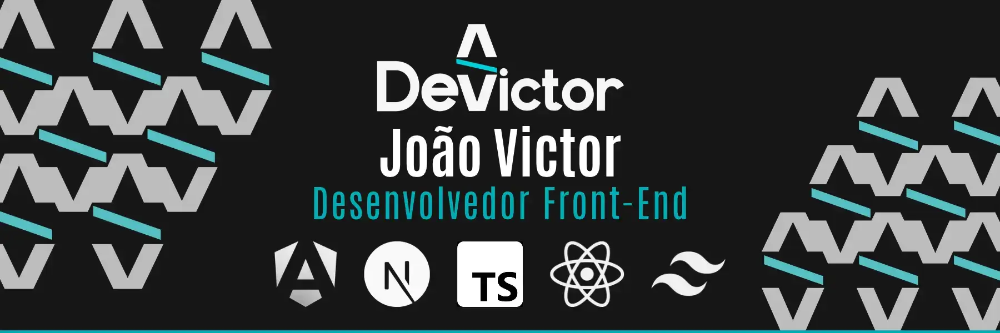

<div align="center">

  

  <br/>

  

  <br/>

  <a href="https://www.linkedin.com/in/soudevictor/">
    
  </a>
  <a href="https://www.linkedin.com/in/soudevictor/">
    
  </a>
  <a href="https://soudevictor.vercel.app/">
    
  </a>
  <a href="mailto:trabalho.joaovictor2004@gmail.com">
    
  </a>
  <a href="https://github.com/soudevictor">
    
  </a>

</div>

## 👋 Sobre mim

```ts
const dev = {
  nome: "João Victor",
  handle: "@soudevictor",
  cargo: "Desenvolvedor Front-End",
  localizacao: "São Paulo, Brasil 🇧🇷",
  formacao: "Análise e Desenvolvimento de Sistemas (UNIP)",

  foco: [
    "Angular (Signals, SignalStore, CDK)",
    "Next.js (App Router, Server Actions)",
    "TypeScript & Design Systems",
    "Core Web Vitals e WCAG 2.2 AA",
  ],

  aprendendo: [
    "Aprofundando Testes E2E com Playwright & MSW",
    "Motion design (GSAP, Framer Motion)",
    "Node.js para ir além do front-end",
  ],

  filosofia:
    "Código bom é aquele que o próximo dev entende e o usuário nem percebe.",
  openToWork: true,

  hobbies: [
    "🎮 jogos competitivos",
    "📽️ terror / horror",
    "🏀 basquete",
    "🎸 rock dos anos 70",
  ],
} as const;
```

## 🧰 Tech Stack

<div align="center">

<p>
  
</p>
<p>
  
</p>


</div>

## 🚀 Projetos em destaque

<div align="center">

<table>
  <tr>
    <td width="50%" valign="top" align="center">
      <a href="https://github.com/soudevictor/axiom-erp">
        
      </a>
    </td>
    <td width="50%" valign="top" align="center">
      <a href="https://github.com/soudevictor/talent-metrics-landing">
        
      </a>
    </td>
  </tr>
  <tr>
    <td width="50%" valign="top" align="center">
      <a href="https://github.com/soudevictor/kurio-jungle-gaming">
        
      </a>
    </td>
    <td width="50%" valign="top" align="center">
      <a href="https://github.com/soudevictor/devictor-portfolio">
        
      </a>
    </td>
  </tr>
</table>

</div>

## 📊 Estatísticas

<div align="center">


</div>

## 🐍 Contribuições

<div align="center">

<picture>
  <source media="(prefers-color-scheme: dark)" srcset="https://raw.githubusercontent.com/soudevictor/soudevictor/output/github-snake-dark.svg" />
  <source media="(prefers-color-scheme: light)" srcset="https://raw.githubusercontent.com/soudevictor/soudevictor/output/github-snake.svg" />
  
</picture>

</div>

## 🤝 Vamos conversar?

> ⚡ Resposta mais rápida por e-mail ou LinkedIn.

<div align="center">

  <a href="mailto:trabalho.joaovictor2004@gmail.com">
    
  </a>
  <a href="https://www.linkedin.com/in/soudevictor/">
    
  </a>
  <a href="https://soudevictor.vercel.app/">
    
  </a>

</div>

<br/>

<div align="center">

_"Primeiro faça funcionar, depois faça certo, depois faça rápido — e **sempre faça acessível**."_

<br/>


</div>
